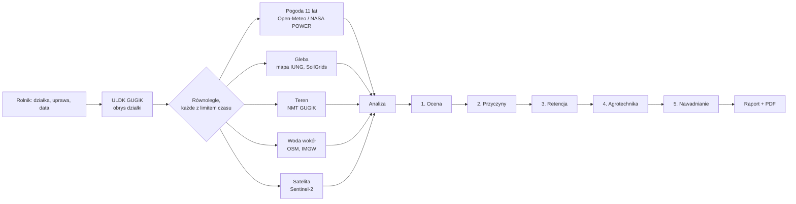

# Jak działa Moje Gospodarstwo

Krótki opis tego, co dzieje się w aplikacji od kliknięcia działki do gotowego raportu. Szczegóły techniczne (źródła, licencje, uruchomienie) są w [README](../README.md), a wyjaśnienie pojęć w [domena.md](domena.md).

## W jednym zdaniu

Rolnik wskazuje działkę i uprawę, a aplikacja w kilkanaście sekund pobiera publiczne dane o pogodzie z 10 lat, glebie, terenie, wodzie i zdjęciach satelitarnych, liczy z nich bilans wodny według metody IUNG-PIB i podaje proste rady: najpierw jak zatrzymać wodę, potem jak uprawiać, na końcu czy podlewać.

## Co widzi użytkownik

1. **Mapa** z panelem „Wybierz działkę”. Klik w pole albo wpisanie numeru (np. `302502_2.0009.387` lub „Sulęcin 387”) pokazuje obrys działki i jej numer – jeszcze bez analizy.
2. Wybór **uprawy** (co rośnie na polu) i ewentualnie **daty** (domyślnie dziś, można cofnąć się do 10 lat).
3. Przycisk **„Analizuj działkę N”** – po 10–30 sekundach otwiera się raport pod własnym adresem (`/raport?dzialka=…&data=…&uprawa=…`), który można odświeżyć albo komuś wysłać.
4. **Raport** w kolejności wymaganej przez KOWR:
   - **Woda na Twoim polu** – jedno słowo („Susza”, „Prawie susza”, „Sucho”, „Woda w normie”, „Mokro”) i jedno zdanie,
   - **Dlaczego?** – przyczyny potwierdzone danymi (mało deszczu, lekka gleba, spływ po stoku, rów odprowadzający wodę…),
   - **Co zrobić?** – rady w trzech grupach: zatrzymaj wodę → uprawa → podlewanie; każda z rozwijanym „Dlaczego i jak?”,
   - **Szczegóły** (zwinięte) – liczby, 10 lat, zdjęcie satelitarne, teren, ograniczenia, źródła.
5. **PDF** do pobrania – ten sam raport na A4, z mapką działki, wykresami i źródłami.

## Co dzieje się pod spodem

### Krok po kroku

1. **Działka.** Serwer pyta ULDK (Usługa Lokalizacji Działek Katastralnych, GUGiK) o działkę – po numerze albo po punkcie na mapie – i dostaje jej obrys, gminę i powiat.
2. **Dane, równolegle.** Każde źródło ma swój limit czasu. Jeśli któreś nie odpowie, raport i tak powstaje, a brak jest wypisany w „Ograniczeniach”. Bez pogody raportu nie ma – to jedyne źródło obowiązkowe.
   - **Pogoda:** dzienny opad i parowanie wzorcowe (ET0) od 11 lat przed datą analizy. Najpierw Open-Meteo (reanaliza ERA5), a gdy odmówi (limit zapytań), automatycznie NASA POWER – wtedy ET0 liczymy sami wzorem FAO-56.
   - **Gleba:** kategoria podatności na suszę (I–IV) z mapy IUNG-PIB, ta sama, której używa państwowy monitoring suszy. Dodatkowo próchnica i uziarnienie z SoilGrids.
   - **Teren:** wysokości w siatce 9 × 9 punktów na działce z numerycznego modelu terenu GUGiK → spadek, kierunek spływu, obniżenia.
   - **Woda wokół:** rowy, cieki, oczka i mokradła w promieniu 600 m (OpenStreetMap), najbliższy wodowskaz i ostrzeżenia o suszy hydrologicznej (IMGW).
   - **Satelita:** ostatnia bezchmurna scena Sentinel-2 z 30 dni – wskaźniki zieloności (NDVI) i wilgotności roślin (NDMI), obraz działki, porównanie z tymi samymi tygodniami w poprzednich latach.
3. **Ocena.** Klimatyczny bilans wodny z 61 dni (deszcz minus parowanie) porównany z **progiem suszy IUNG** dla tej uprawy i gleby, z **tym samym okresem w 10 poprzednich latach** i z **zapasem wody w strefie korzeni**. Satelita tylko potwierdza – nie rozstrzyga sam.
4. **Przyczyny.** Reguły sprawdzają, co dane potwierdzają: deszcz poniżej normy, upał, lekka gleba, mało próchnicy, spadek terenu, rów przy działce, faza uprawy, słabsza roślinność.
5. **Rady.** Też reguły, ale dopasowane do działki: rów 20 m od pola → „zatrzymaj wodę w rowie”, obniżenie na polu → „nie osuszaj go” (punkt na mapie), stok → „orz w poprzek”. Podlewanie tylko w sezonie i tylko gdy w strefie korzeni zabrakło wody łatwo dostępnej; dawka z bilansu, termin z prognozy.
6. **Niepewność.** Każdy raport wylicza poziom pewności i listę ograniczeń (np. zapasowe źródło pogody, brak bezchmurnego zdjęcia, rowy z niekompletnej mapy).
7. **Podsumowanie** jest składane z szablonu. Opcjonalnie model językowy (Claude) przepisuje gotowe liczby i rady na 2–3 zdania – niczego nie liczy i nie wymyśla.

## Czego aplikacja NIE robi

- Nie mierzy niczego na polu – korzysta z modeli, map i satelity. Lokalna burza może zmienić obraz sytuacji.
- Nie zna faktycznej fazy rozwoju roślin, zabiegów na polu, wód gruntowych ani tego, czy pole jest już nawadniane.
- Nie zbiera danych osobowych. Raporty zapisuje tylko w przeglądarce użytkownika.
- Nie zastępuje doradcy – raport ma pomóc w rozmowie z ODR albo spółką wodną.

## Gdzie co jest w kodzie

| Co | Gdzie |
|---|---|
| Ekran mapy, formularz, adresy (routing) | `client/src/App.jsx` |
| Raport na ekranie | `client/src/components/Report.jsx` |
| Raport PDF | `client/src/pdf/reportPdf.js` |
| Składanie raportu, limity czasu | `server/src/report.js` |
| Ocena, przyczyny, rady, niepewność | `server/src/engine.js`, `server/src/analysis/*` |
| Źródła danych | `server/src/sources/*` |
| Progi IUNG, uprawy (Kc) | `server/src/data/*` |
| Satelita bez bibliotek (GeoTIFF, PNG) | `server/src/cog.js`, `server/src/png.js` |
